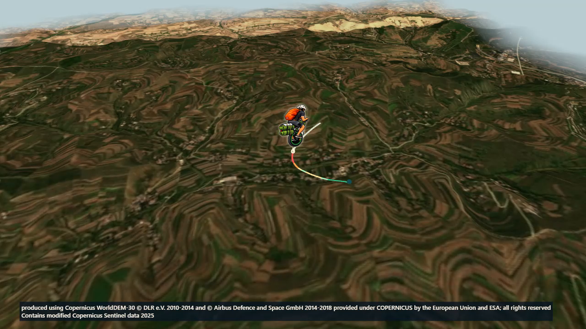

# Автоматическая фотографическая 3D-карта — кандидат

Реализовано в ветке `codex/automatic-photographic-terrain`, поверх main `1c7e5a078472981308d90abef1ee13a7f521038a`. Публичный сайт и защищённый Pages workflow не изменены. Для локальной проверки включить `BUILD_AUTO_GEOGRAPHY=1`; обычная производственная сборка сохраняет прежние пакеты и ограничения.

После локального импорта GPX вне Furka/Sogne приложение предлагает согласие на передачу округлённой области поездки. После согласия автоматически ищет Sentinel-2 L2A RGB/SCL в Earth Search и Copernicus DSM в Microsoft Planetary Computer, читает необходимые COG-фрагменты и обзоры, преобразует UTM/WGS84 в согласованную локальную метрическую сетку, проверяет фото/DEM и передаёт результат прежнему TerrainRenderer. Пользователь не ищет GeoTIFF и не запускает преобразования вручную. GPX, точки, имя файла и метки не отправляются. Каталоги видят области с округлением наружу до0,1°; хранилища также видят запросы блоков COG для широкого подготовленного охвата. Это раскрывает приблизительную местность и IP браузера, поэтому запросы запрещены до согласия.

## Источники и проверка доступа

- [Earth Search](https://github.com/Element84/earth-search): Sentinel-2 L2A RGB10м и SCL20м. Сначала оцениваются облачность и доля no-data сцены, затем реальные SCL-пиксели подготовленного охвата и локальный коридор вдоль всех исходных сегментов. Покрытие собирается раньше дополнительных дат. Допускается≤2% облачных/неопределённых пикселей сцены и≤1% проверяемого коридора; отсутствующие/дефектные пиксели не заполняются выдуманными данными. Эти пороги — инженерная политика качества SCL, не гарантия отсутствия облаков. Снег остаётся снегом, разные даты могут образовывать мозаику.
- [Microsoft Planetary Computer](https://planetarycomputer.microsoft.com/docs/concepts/sas/): Copernicus GLO-30, затем GLO-90 при отсутствующем/неполном покрытии. Анонимный временный read-ticket выдаётся для проверенного COG-адреса; подписанный URL не сохраняется в Git, отчётах или дисковом кеше. Проверен настоящий браузерный HTTP206. [Copernicus DEM](https://dataspace.copernicus.eu/explore-data/data-collections/copernicus-contributing-missions/collections-description/COP-DEM) — DSM, включает растительность/постройки; вертикальные высоты EGM2008, не фактическая высота дороги и не GPX-альтиметрия.
- Прямые AWS Copernicus COG отвечают HTTP206 в Node, но браузер CORS не проходит. Не используются как якобы работающий browser-only источник. Copernicus Data Space STAC collections доступны, его конечные исходные assets пока NOT TESTED. JAXA и новые национальные источники не подключены без отдельной проверки.

[Sentinel legal notice](https://sentinels.copernicus.eu/documents/247904/690755/Sentinel_Data_Legal_Notice) и [Copernicus DEM licenses](https://dataspace.copernicus.eu/sites/default/files/media/files/2025-06/copernicus_contributing_mission_data_access_v2_cop_dem_licenses.pdf) разрешают соответствующую переработку/публичное использование при соблюдении уведомлений. Полная атрибуция сохраняется в видео даже без необязательных пояснений; условия не заменяются лицензией MIT приложения. Полные notice/ответственность/источники зависимостей включены в THIRD_PARTY_NOTICES.md и licenses/GEOGRAPHIC_DEPENDENCIES.txt.

## Ограниченная архитектура

`geographic-plan.ts` анализирует все исходные сегменты, сохраняет координаты и короткую дугу антимеридиана. Выбирает один ограниченный обзор с полем камеры; длинный путь может помещаться, если его географический размах≤55км. Огромные и сильно разнесённые сцены получают явный2D fallback, GPX не обрезается. Несколько отдельных дальних географических сцен/последовательный tile swap не реализованы; это следующий возможный этап, не скрытый мировой кеш.

`geographic-discovery.ts` отделяет выбор снимков от DEM и существующих региональных пакетов. Проверяемые поставщики можно расширять через этот интерфейс; сейчас подтверждён один источник фотографий и один источник DEM. Нет фиктивного списка новых поддержанных стран или обещания покрытия всего мира.

`geographic-network.ts` разрешает четыре точных HTTPS origin и конкретные пути, запрещает редиректы, credentials/referrer, большие полные TIFF вместо Range, ограничивает ответы, суммарную загрузку64МиБ/1200запросов/180секунд и две одновременные загрузки. COG Content-Range проверяется, если доступен; в протестированных хранилищах этот заголовок не открыт браузеру через CORS, поэтому обязательны HTTP206/точный размер/проверка TIFF. Исходный полный COG SHA-256 не получен при Range-доступе; контрольные суммы подготовленных JPEG и высот вычисляются и повторно проверяются. Не следует выдавать локальный derived hash за официальный hash полного исходного TIFF.

`geographic-cog.ts` выбирает фактический overview до декодирования, ограничивает исходное окно8млн пикселей и подготовленный растр3млн, проверяет CRS/разрядность/размер блока. EPSG326xx/327xx преобразуется через pinned proj4, не GCJ-02/BD-09. Учитываются PixelIsPoint DEM и north-up UV; не смешиваются неизвестные вертикальные датумы.

`geographic-preparation.ts` создаёт общую фотографию и DEM≤1MB/500kvertices, сохраняет максимум один JPEG≤2MiB и одну сетку в RAM, освобождает bitmap при отмене/замене, очищает кеш при pagehide. DEM-only recovery использует уже подготовленный DEM, если фото не прошло качество. Дискового кеша, GPX/маркеров/истории в кеше нет. Качество Compatibility/Standard не изменяет географические данные произвольно.

Существующий поставщик `scene-provider.ts` и главный контроллер остаются единственными. Новая загрузка отменяет старую; устаревшие результаты проверяются через AbortSignal/идентификатор операции. Экспорт получает прежний неизменяемый StoryConfig. До разрешения экспортировать проверяется вся временная шкала камеры. Сохраняются350м clearance, точная LOS, геометрия/сегменты/уклоны, 24FPS,10/20/30секунд и предел32MiB MP4. Для новых широких сцен применяется65° FOV и проверка≤2 projected pixels на подготовленный ground texel; существующие46° Furka/Sogne не изменены. Поиск допустимого масштаба имеет конечное число шагов и предел80км, не ослабляет clearance.

## Приёмка и память

Runtime SHA `b60ff10278b028e9dd571457f9a5f351ba727039`; [PR26](https://github.com/Matawaka/route-story/pull/26), [successful runtime CI](https://github.com/Matawaka/route-story/actions/runs/38394423985). Локально263unitPASS, TypeScript/VitePASS,62routine browserPASS/37explicit skips,5новых opt-in failuresPASS, clean install/audit0. Финальный documentation-only HEAD проверяется отдельно, эти результаты относятся к указанному runtime.

Ниже — настоящий независимо декодированный кадр первой китайской сцены. География Sentinel/Copernicus настоящая; короткий маршрут специально синтетический, не поездка человека. Встроенный rider сохранён, источники подписаны в кадре. Это evidence в документации, не новый публикуемый региональный пакет.

Локально на Edge155.0.4283.45 / Windows10.0.26200 автоматически подготовлены реальные пользовательские Mont Blanc/Malerweg и три независимых синтетических китайских области. Для каждой получены20s16:9 и30s9:16 Standard H.264 MP4, independently decoded FFmpeg/ffprobe, exact pre-encode/preview/reverse-seek equality, all-frame nonblank/PTS/changing checks, cancel/retry и отсутствие внешних запросов во время экспорта. GPX и видео владельца находятся только в ignored artifacts; подробные агрегированные значения — AUTOMATIC_GEOGRAPHY_EVIDENCE.json.

Источник подготавливался15–38секунд, скачано22–55MB в отдельных измеренных запусках. Это не медианы и не SLA. Сумма private memory изолированного браузера в отдельных экспортных выборках достигает примерно0,8–1,0GiB. Измерение Windows Get-Process по уникальным PID собственного браузера/CDP включает browser/renderer/media/GPU-process RAM; не означает GPU VRAM. Working set может учитывать общие страницы. Период750мс не ловит гарантированно точный пик. JS heap/VRAM отдельно NOT MEASURED. Один цикл не доказывает отсутствие утечек; retained memory после удаления маршрута включает обычные браузерные/кодековые кеши. Физические Xiaomi/MacBook и маломощный ноутбук для нового механизма NOT TESTED. До публичного включения нужны такие проверки;2D остаётся доступным.

## Инфраструктура и выпуск

| Путь | Стоимость в этой проверке | Память/скорость | Приватность/надёжность |
|---|---|---|---|
| Browser-only | Новые платные ресурсы не требуются | Измеренные15–38s и высокий native RAM | GPX локален; согласованный охват доступен поставщикам; нет SLA каталога, CORS/сеть могут отказать |
| Имеющийся Timeweb VPS | Не задействован; доступ/конфигурация/стоимость не проверялись | Мог бы вынести TIFF-подготовку, измерений нет | Потребовал бы отдельного deployment/security review, серверных лимитов/SSRF allowlist и операционных обязательств |
| Бесплатный ограниченный сервис | Не создан, квоты/аккаунты не проверялись | Нет измерений; лимиты CPU/RAM/egress могут мешать | Новая внешняя зависимость и согласование; для доказанного пути не нужен |

Не обещаем нулевую стоимость неизвестного VPS и не предлагаем оплачивать новый API. Реализованный путь не требует VPS. Базовые5MiB, Sogne6MiB, Furka9MiB и Pages защита сохранены. Candidate decoder addon≤512KiB измеряется отдельно; standalone geography candidate требует локального лимита5.5MiB, это НЕ разрешение на публикацию или глобальное увеличение старых лимитов. Обычный workflow не включает BUILD_AUTO_GEOGRAPHY. Публичное включение/CSP/пакет и merge требуют отдельного решения владельца.

## Воспроизведение

PowerShell: `npm.cmd ci`; `$env:BUILD_AUTO_GEOGRAPHY='1'`; `$env:SWISS_BASELINE='1'`; `npm.cmd run dev -- --port 4195 --strictPort`. В интерфейсе загрузить GPX, прочитать согласие, нажать «Разрешить поиск и подготовить3D». Для готовых Furka/Sogne внешнего поиска нет.

`node scripts/acceptance/automatic-geography.mjs <локальный-путь-GPX> <короткая-метка> --full` проверяет реальную сцену/оба MP4/память. `node scripts/acceptance/china-geographic-fixtures.mjs` создаёт только явно синтетические fixtures в ignored artifacts. Перед реальными внешними запросами по частным трекам необходимо согласие владельца; разрешение для двух нынешних треков получено2026-10-13.

Routine: `npm.cmd run check`. Opt-in failures: `BUILD_AUTO_GEOGRAPHY=1`, `AUTOMATIC_GEOGRAPHY_ACCEPTANCE=1`, `npx.cmd playwright test automatic-geography.spec.ts`. Candidate package: `npm.cmd run build`; `node scripts/package-release.mjs --automatic-geography-candidate`. Не использовать candidate flag как обход публикационной защиты.
