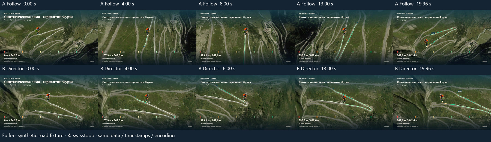
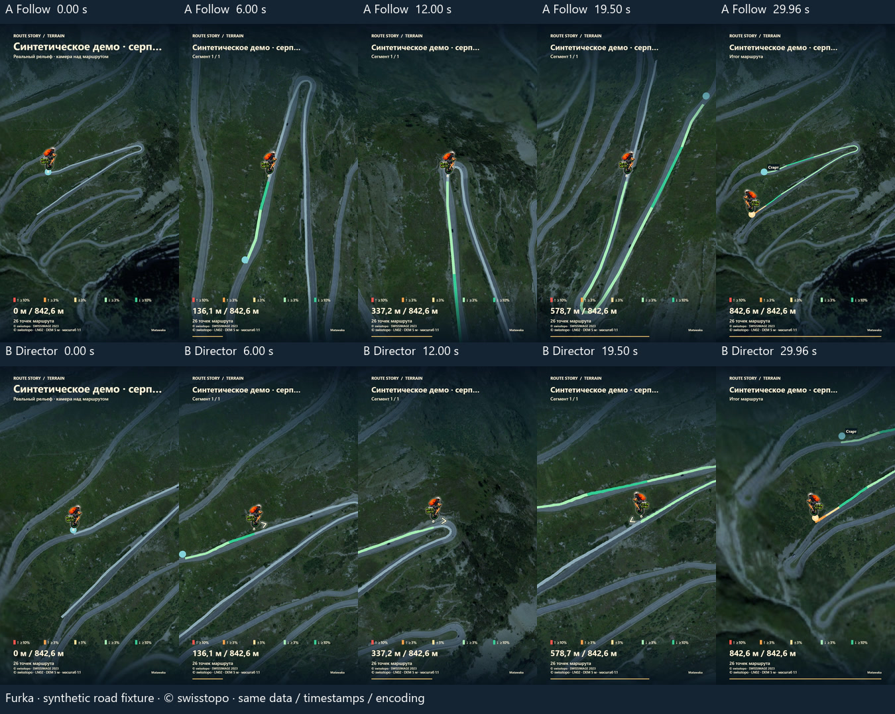

# MVP 1.6 — реальные A/B-видео и ограничения

Проверенный runtime: `ab29fb67ef3426e4e4e93e93e089aa040936fbc8`, PR #29. Windows build 26200 / Edge 155.0.4283.45 / RTX 3090. Данные получены из настоящих локальных отчётов, а не расчётных оценок. В каждой A/B-паре совпадают маршрут, DEM, фотографии, стиль, подписи, маркер, уклоны, темп, длительность и настройки кодировщика; отличается только камера. Контрольные суммы этой идентичности проверены локально. Частные координаты, исходные GPX, видео и их отпечатки не опубликованы.

## Полные экспорты

| Сцена / режим | Размер / время | Кадры | MP4, МиБ | Создание видео, с |
| --- | --- | ---: | ---: | ---: |
| Furka A / прежняя камера | 1920×1080 / 20 с | 480 | 25,51 | 10,20 |
| Furka B / режиссёр | 1920×1080 / 20 с | 480 | 24,77 | 9,96 |
| Furka A / прежняя камера | 1080×1920 / 30 с | 720 | 37,65 | 16,48 |
| Furka B / режиссёр | 1080×1920 / 30 с | 720 | 35,77 | 14,18 |
| Mont Blanc A / прежняя камера | 1080×1920 / 30 с | 720 | 37,09 | 15,57 |
| Mont Blanc B / режиссёр | 1080×1920 / 30 с | 720 | 37,08 | 15,14 |
| Malerweg A / прежняя камера | 1080×1920 / 30 с | 720 | 37,89 | 14,34 |
| Malerweg B / режиссёр | 1080×1920 / 30 с | 720 | 37,82 | 14,41 |
| Furka B / режиссёр, запись в файл | 3840×2160 / 10 с | 240 | 34,42 | 18,84 |
| Furka B / режиссёр, запись в файл | 2160×3840 / 10 с | 240 | 33,07 | 17,35 |
| Sogne / прежняя камера | 1280×720 / 20 с | 480 | 12,49 | 8,47 |
| Sogne / прежняя камера | 720×1280 / 20 с | 480 | 12,62 | 8,49 |

24 FPS во всех файлах. FFmpeg/ffprobe полностью декодировали все кадры, проверили H.264, размеры, длительности, timestamps, изменяющееся изображение и отсутствие пустой центральной карты. Отдельно прошли точные равные по разрешению preview/pre-encode пиксели, неизменность геометрии/времени при смене качества и отсутствие внешних запросов во время кодирования. В каждой из пяти серий прошли отмена и повторный 10-секундный MP4: ещё пять независимо декодированных файлов. Новые 4K используют AVC High Level 5.1, Full HD — High Level 4.0, прежний Standard — Baseline Level 3.1.

Время в таблице — один наблюдённый интервал создания MP4 внутри приложения. Оно не включает поиск карт, последующее сохранение тестовым браузером и независимое декодирование; не является медианой или обещанием для другого устройства. Новый план не даёт большого ускорения кодировщика, а добавляет предварительную проверку камеры.

## Плавность и композиция

| A → B | Максимальный поворот, °/с | RMS ускорения виртуальной камеры, м/с² | Максимальное ускорение, м/с² |
| --- | ---: | ---: | ---: |
| Furka 20 с / 16:9 | 284,68 → 4,09 | 1010,65 → 55,23 | 11807,88 → 180,48 |
| Furka 30 с / 9:16 | 284,68 → 7,86 | 578,04 → 45,56 | 5848,94 → 157,76 |
| Mont Blanc 30 с / 9:16 | 0 → 4,86 | 21825,18 → 4171,59 | 70224,61 → 20824,53 |
| Malerweg 30 с / 9:16 | 0 → 9,78 | 16405,50 → 5070,20 | 52289,04 → 56218,98 |

Это конечные разности по кадрам 24 FPS внутри одного сегмента, включая вступление/финал; отдельное математическое доказательство проверяет безопасность всей непрерывной кривой. Это не измеренная скорость человека, не jerk непрерывной траектории и не объективная оценка зрительского комфорта. Старое сопровождение длинных треков уже удерживало север и имело нулевой yaw. Новые небольшие повороты раскрывают ландшафт; нельзя утверждать, что каждый показатель улучшился.

У Malerweg RMS снизился примерно на 69%, но отдельный максимум ускорения выше старого примерно на 7,5%. Промежуточная версия принудительно тормозила после каждого монтажа и давала 79 740 м/с²; one-sided tangents уменьшили этот пик, сохранив географические разрывы и полную проверку безопасности. C1 не означает C2: остаточные ускорения и короткие сегменты остаются предметом визуальной оценки владельца. В 10-секундном вертикальном Furka поворот достигает 30,83°/с; более длинные ролики спокойнее, и отсутствие укачивания не сертифицировано.

В каждом новом B-ролике: 0 выходов центра маркера из безопасной области, 0 LOS-окклюзий и 0 кадров с неполным покрытием полезной карты. Минимальный clearance остаётся ≥350 м. На старом Malerweg 42 состояния вне новой безопасной области и 36 с неполным полезным покрытием; новая камера устраняет эти случаи. Старое Sogne сохранено: горизонтальный обзор имеет 37 состояний вне **нового** прямоугольника маркера и 46 неполных полезных footprints. Это ограничения прежней композиции, а не успешная сертификация Sogne как нового режиссёрского плана.

Независимая проверка исходного Swiss DEM 2 м также прошла для всех четырёх новых Furka-видео. Минимальный clearance целого cubic control hull над исходными клетками: 600,35 м (20 с / 16:9), 674,63 м (30 с / 9:16), 595,78/673,56 м (10 с / 4K). Native triangle LOS взгляда и маркера проверена на всех 481/721/241/241 состояниях, включая оба конца; минимум свободной высоты 21,40–22,52 м при прежнем ramp 8 м. Это сохраняет developer-проверку исходного рельефа; runtime непрерывная LOS доказывается по отображаемой 5 м сетке. Сырой 9 MB float reference не передаётся браузеру и не публикуется.

Furka/Sogne — явно синтетические демонстрации. Mont Blanc/Malerweg — исходные GPX владельца; их контактные листы и видео доступны только локально в ignored `artifacts/high-resolution/director-review-*-ab-fullhd`. Изображения контактных листов только декодированы, уменьшены и подписаны; география не ретушировалась.

## Подготовка и память

План Furka 20/30 с: 0,36/1,02 с и 2106/5414 proof intervals. Mont Blanc: 1,05 с / 16284 интервала; Malerweg: 0,96 с / 15175. Общий cap 30 000 включает обе попытки. Целиком начальная подготовка географии/сцены: Furka ≈1,04 с, Mont Blanc ≈39,18 с, Malerweg ≈21,67 с. Сетевое время меняется: предыдущий Mont Blanc запуск занимал ≈105,58 с, и это не скрывается как якобы стабильная скорость.

Mont Blanc скачал 52,1 МиБ; Sentinel источник 10 м → подготовленный обзор 50 м; Copernicus DSM 30 м → сетка 120 м. Malerweg: 27,4 МиБ; фото 10 м → 30 м, DSM 30 м → 80 м. Это обзорные фотографии с настоящим рельефом, без детализации отдельных улиц. Furka использует прежние локальные swisstopo слои 3 м / 0,5 м и 5 м mesh из 2 м DEM. Оптический native class 10/25 см не доказан. Новое качество видео не создаёт новой географической информации.

Наблюдённые максимумы process-private memory за **всю** A/B/регрессионную сессию: Furka Full HD 969,5 МиБ, Mont Blanc 1117,2 МиБ, Malerweg 1020,0 МиБ, Furka 4K 1423,3 МиБ, Sogne 915,3 МиБ. Метод: уникальные PID из isolated browser/CDP, Windows Get-Process, выборка раз в секунду. Это не отдельные аллокации A/B-камер, не точный пик, не VRAM, не JS heap и не доказательство отсутствия всех утечек. PNG-инструментирование проверки пикселей также расходует память. Никакого универсального «memory-safe на телефоне» утверждения.

Режиссура добавляет ограниченный CPU prefix-grid/ключи и не добавляет GPU-текстур или контекстов. Proof scratch освобождается после подготовки; кадровая функция использует только готовый план. Ни лимиты исходных фото/DEM, ни бюджеты MP4, ни лимиты 5/6/9 МиБ производственных пакетов не увеличены. Измеренные полные пакеты, включая release.json: baseline **5 042 068 B ≤5 MiB**, Sogne **6 047 597 B ≤6 MiB**, combined Furka/Sogne/автогеография **8 519 132 B ≤9 MiB**. Рост combined относительно MVP1.5 — 25 504 B; новые карты или зависимости не добавлены. Реальная file-stream проверка использовала временный OPFS файл тестового окружения и удалила его; физический native save-picker не тестировался, в продукте OPFS-хранение не вводится.

Физические macOS/Android/iOS, обычный ноутбук, новые китайские сцены и полный 60-секундный **новый director MP4** — NOT TESTED. 60-секундный план Furka проверен unit-тестом, прежний минутный экспорт проверялся в MVP 1.5; эти факты не заменяют новый полный видеотест. До выпуска нужны визуальное одобрение PR #29 и отдельное разрешение на слияние/публикацию; текущий публичный сайт не изменялся.
