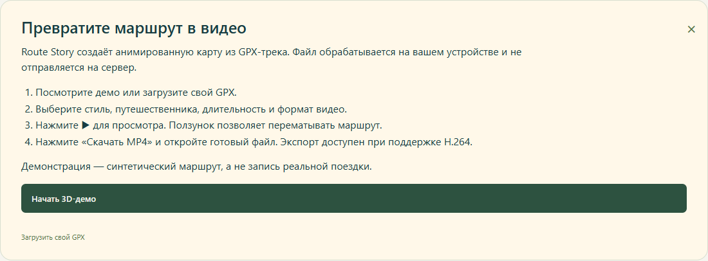
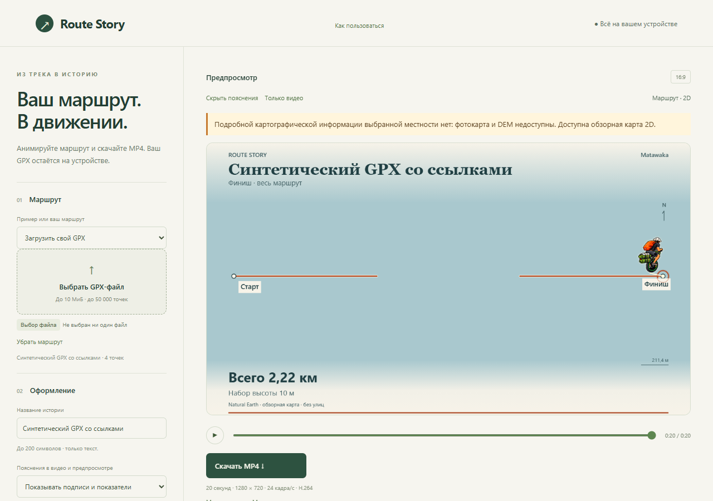
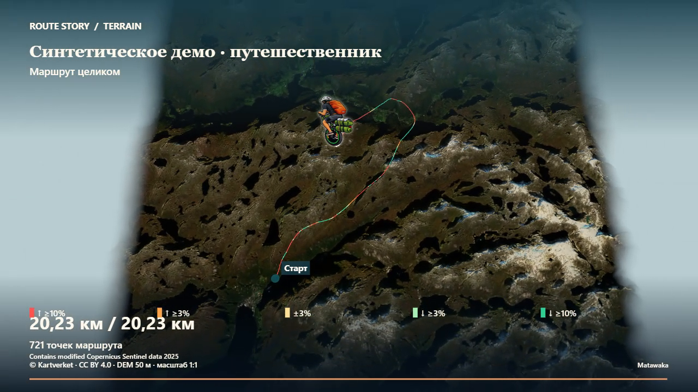

# Приветствие, доступные карты и направление путешественника

Локальный кандидат от 2026-10-13: [PR #25](https://github.com/Matawaka/route-story/pull/25), `codex/marker-left-facing`, база `3119cee84fd0ed435c766b40b4543cfcfe3abaa2`, проверенный код `d9311381adb5038af1e43b99fec8f078107fa368`. Последующие коммиты содержат документацию и доказательства. Новое слияние/публикация ожидает одобрения владельца. Отдельный PR #24 с журналом предыдущей публикации сюда не включён.

## Первый запуск

Перед движением демо показывается приветствие с четырьмя шагами: выбрать демо/GPX, настроить видео, посмотреть/перемотать, скачать MP4. Есть «Начать 3D-демо», «Загрузить свой GPX» и закрытие. Swiss готовится в фоне; воспроизведение начинается после подтверждения. При reduced motion кадр остаётся статическим до ▶. Самостоятельный выбор маршрута/настроек отменяет отложенный старт: поздняя загрузка Швейцарии не заменяет собственный GPX.

«Как пользоваться» возвращает инструкцию, ставит воспроизведение на паузу и сохраняет маршрут, настройки и кадр. Приветствие не записывается в хранилище, не входит в StoryConfig и появляется при новом открытии страницы. Критические сообщения и атрибуция сохраняются.



[Первый экран](images/welcome-start-desktop.png) · [экран 375×812](images/welcome-start-mobile.png).

## Карта и DEM

Проверка допуска использует существующий региональный провайдер: строгий Furka descriptor и маленькое описание границ Sogne, сверяемое с действующим манифестом. Проекция общая с DEM. Координаты/GPX не отправляются сервисам.

Вне покрытия: «Подробной картографической информации выбранной местности нет: фотокарта и DEM недоступны. Доступна обзорная карта 2D.» В списке остаются Classic/Cinematic 2D, недоступные 3D-элементы скрыты. Сообщение видно также в компактном режиме и «Только видео». Если Sogne photo pack не включён в сборку, фототекстура не предлагается. При выборе покрытого демо варианты восстанавливаются до применения его настроек.

Метаданные не заменяют проверки реальных высот, no-data, коридора, 350 м clearance, точного LOS и готовности ресурсов. Наличие пакета не делает любой GPX внутри прямоугольника пригодным для безопасного 3D-пролёта. Ошибки загрузки/графики сохраняют явное восстановление.



## Разворот маркера

Направление определяется настоящим ненулевым ребром текущего сегмента и текущей проекцией камеры, без истории кадров. При движении влево растр отражается горизонтально и остаётся вертикальным; для почти вертикального направления есть маленькая относительная зона округления. Старт/финиш используют настоящее первое/последнее ребро, независимые сегменты не соединяются. Дубликаты и стационарные точки безопасны.

В 2D/3D-аннотации отражается существующий Canvas-растр. Опциональный depth-tested sprite меняет UV существующей текстуры. Исходный PNG не меняется; дополнительная текстура не создаётся. Стрелка рисуется отдельно только во время replay. Геометрия DEM/линий сохраняет depth testing и географическую привязку.

Это действует для встроенных и локальных PNG/WebP/JPEG. Программа не распознаёт ориентацию произвольного рисунка: левый вариант — зеркало исходного, включая текст внутри него.



[Вправо](images/marker-right-facing.png) · [тот же растр влево](images/marker-left-facing.png) · [3D-аннотация](images/marker-left-facing-3d.png).

## Проверки

Windows_NT 10.0.26200 / Microsoft Edge 155.0.4283.45. Новые физические устройства и пики native/GPU памяти **NOT TESTED / NOT MEASURED**; предыдущие результаты не выдаются за новые.

- 238 unit-тестов / 22 файла, TypeScript/Vite build PASS.
- Обычный browser-прогон: 62 passed, 32 явно opt-in skipped, 0 failed.
- Полный unified/welcome/rider/captions/marker: 32 passed, 1 skipped, 0 failed. Пропуск — исходный локальный JPEG владельца без `OWNER_JPEG_PATH`; синтетический JPEG 1254², EXIF, сигнатуры, лимиты и очистка проверены.
- Пять растров дают точное RGBA-зеркало, исходник и transform сохраняются. Восемь 2D-комбинаций и 3D-аннотация/sprite проверяют оба направления и точную обратную перемотку. Текстур стабильно ≤3 (две фото + маркер).
- Production `/route-story/`: все 31 hash/длины файлов, приветствие до autoplay, mobile375 без переполнения, мета-CSP, отсутствие сторонних запросов/отправок/хранения, cancel/retry и unsupported encoder с доступным preview. Swiss и общий release smoke также создали пять настоящих коротких MP4 с независимым декодированием и нативным воспроизведением.
- Чистая установка по точному lockfile в отдельной игнорируемой папке и аудит: 0 уязвимостей. Работающий Windows preview блокировал native-модуль при попытке очистить исходный node_modules; зависимости восстановлены без изменения lockfile и остановки сервера.

Полные настоящие H.264 / 24 fps: все кадры декодируются, timestamps и непустое меняющееся изображение проверены:

| Сцена | Размер, длительность | Кадры | Байты | Один замер экспорта |
|---|---|---:|---:|---:|
| Sogne Atlas, с подписями | 1280×720, 20 с | 480 | 13 425 773 | 1 282,3 мс |
| Sogne Night, с подписями | 720×1280, 30 с | 720 | 19 419 720 | 1 712,8 мс |
| Furka Atlas, без пояснений | 1280×720, 20 с | 480 | 13 022 379 | 1 553,3 мс |
| Furka Night, без пояснений | 720×1280, 30 с | 720 | 19 157 496 | 2 089,8 мс |

Sogne замеряет только export (подготовка 301,3/282,2 мс); Furka включает export/download/save, исключая FFmpeg. Это единичные измерения с разными границами, без заявлений об ускорении/регрессии. Preview и кадр перед encode совпадают точно; декодированное видео сравнивается с допустимой погрешностью H.264. Кадр выше извлечён FFmpeg на 19,9583333333 с из Sogne Atlas. Тестовые `*.frame-*.png` rider являются исходными кадрами до encode и не называются независимым декодированием.

Видео/полные отчёты локальны в `artifacts/sprint11/full`, `artifacts/video-captions`, `artifacts/marker-facing`. Точные SHA-256/условия: [MARKER_UX_EVIDENCE.json](MARKER_UX_EVIDENCE.json). В Git только синтетические скриншоты/отчёты. Полные production-размеры с release.json: **4 965 545 / 5 971 039 / 7 991 469 байт**, в прежних пределах 5/6/9 МиБ. Источники, зависимости, пакеты, лимиты и deployment permissions не менялись.

PowerShell (перед npm.cmd ci остановить только свои локальные серверы, удерживающие native-модули):

```powershell
npm.cmd ci
$env:PLAYWRIGHT_CHANNEL='msedge'
$env:CI='1'
$env:SWISS_BASELINE='1'
npm.cmd run check
$env:SWISS_PILOT='1'
$env:SWISS_BASELINE='0'
$env:UNIFIED_UX_ACCEPTANCE='1'
$env:FULL_EXPORT_ACCEPTANCE='1'
npx.cmd playwright test tests/e2e/unified.spec.ts tests/e2e/welcome-coverage.spec.ts tests/e2e/rider.spec.ts tests/e2e/captions.spec.ts tests/e2e/marker-facing.spec.ts
$env:BUILD_IMAGERY_PACK='1'
$env:BUILD_SWISS_PACK='1'
npm.cmd run build
node scripts/package-release.mjs --imagery-release --swiss-release
node scripts/acceptance/swiss-public.mjs
node scripts/acceptance/release.mjs --smoke
```

Кандидат проверен локально. Следующий шаг — review владельца, разрешение на merge/deploy, exact-main CI, личное подтверждение `github-pages` и настоящая HTTPS-приёмка. Публичный main3119cee/стабильные теги сохранены.
