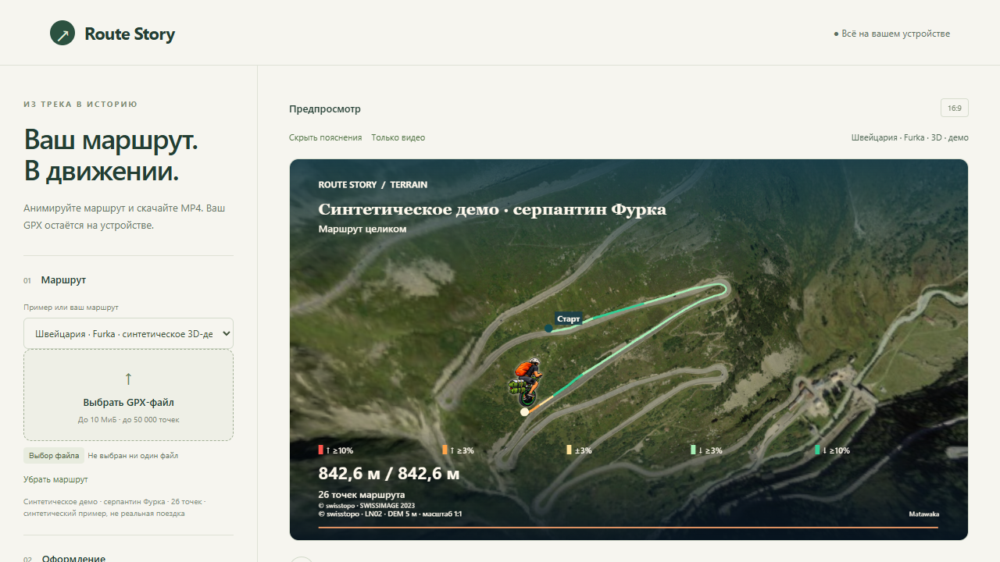
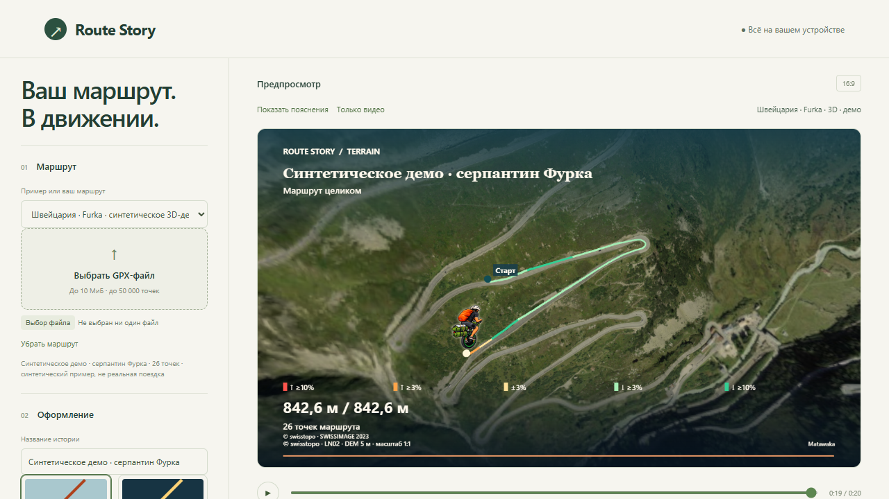
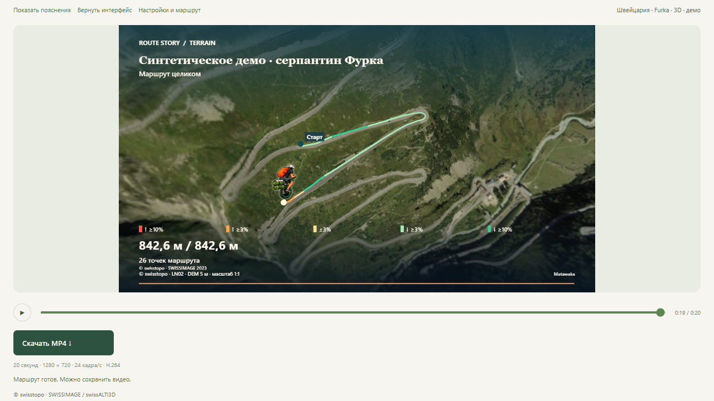
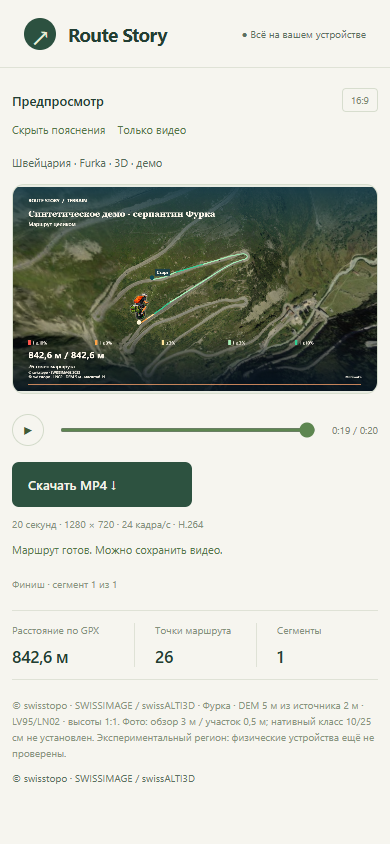

# Единое приложение и стартовая Furka — кандидат

Основа: main `d1c2b85f1ebbd2c7d167982b97fc6aa956ea2d83`. Публичная версия до одобрения этого PR не изменяется. Новое поведение проверяется локально, а не объявляется опубликованным.

Главная страница автоматически выбирает существующий синтетический Furka GPX: 26 точек, 842,6 м. Это не запись поездки человека. Настройки: настоящие фото/DEM, проверенный коридор, цвет и художественный темп по уклону, «Шах - вкрутанидзе», 16:9, 20 секунд, Standard. Автозапуск существует только в первоначальной инициализации; reduced motion оставляет статический 3D-кадр. Последующие демо, GPX и повтор загрузки не запускают начальный выбор снова.

`src/main.ts` — единственный пользовательский контроллер. `src/ui-state.ts` определяет INITIALIZING, LOADING, READY, PLAYING, PAUSED, EXPORTING, EMPTY, ERROR, CANCELLED. Encoder capability — отдельный результат, поэтому неподдерживаемый MP4 не блокирует просмотр. Отклонённая замена картинки не уничтожает прежнюю готовую сцену. Конфигурация экспорта по-прежнему заморожена; exporter, timeline и алгоритмы камеры не переписаны.

Поле названия доступно во время подготовки уже принятого маршрута. Ввод сгруппирован паузой180мс: не создаётся новая GPU-сцена на каждую букву. LOADING блокирует экспорт до фиксации последнего значения; отмена/смена маршрута/pagehide отменяют также этот таймер. Клавиатурный ввод и отмена устаревшего названия проверены отдельным браузерным сценарием.

`src/scene-provider.ts` повторно использует `regionalPackForRoute`, Swiss/Sogne/imagery/geography loaders и прежние рендереры. Swiss coverage/frame proof, 350 м clearance, LOS, true-height, UV, данные и атрибуция не менялись. При загрузке собственного GPX из 3D-демо видимый режим переключается на существующее «Авто»: выбранная 2D/3D-сцена и объяснение fallback отображаются явно. Принудительный 3D вне покрытия возвращает ошибку с кнопкой 2D. Другие пользовательские настройки не сбрасываются при импорте.

Одна активная подготовка владеет AbortController. Выбор другого маршрута, отмена, повтор и pagehide отменяют или игнорируют устаревший результат. Старый renderer освобождается до декодирования новой пары снимков; не возникает дополнительной резидентной пары текстур. Context loss обнаруживается и в паузе, после чего доступны повтор и явная 2D-карта.

Явная «Открыть упрощённую карту · 2D» выбирает Classic. Если подложку невозможно получить из-за сети/тайм-аута/отказа файла, она отображает только честную локальную геометрию GPX и явно сообщает об отсутствии подложки. Повреждённая география не принимается как готовая. Если недоступен именно встроенный rider asset, действие выбирает простой point, что видно в настройках; готовый пользовательский/встроенный маркер в остальных случаях сохраняется. Проверено восстановление без заранее кэшированной карты при отключённой сети.

`src/local-resource.ts` ограничивает каждый файл 30 секундами, включая зависший поток, и проверяет лимиты до принятия пакета. Загрузки не повторяются автоматически. Этапы показываются без выдуманного общего процента/ETA. H.264 capability probe ограничен 10 секундами. RAM-кэш ≤2 МиБ хранит только SHA-проверенные публичные байты фиксированных ресурсов; возвращает копии, имеет LRU eviction, очищается на pagehide. Незавершённые/повреждённые загрузки, частные GPX и пользовательские картинки не кэшируются и не сохраняются. Это дополнительно до 2 МиБ CPU-памяти, не измерение native/GPU memory. Валидированные исходные geography/terrain кэши сохранены; неуспех не отравляет повтор.

Режимы normal/compact/video управляются одной точкой вне StoryConfig. Необязательные пояснения скрываются; статус, отмена, ошибки и source credit остаются. «Только видео» раскрывает настройки по кнопке. На мобильном экране предпросмотр идёт первым. Изменение интерфейсного режима не перерисовывает и не меняет экспортируемые кадры.

Публичный `swiss-pilot.html` — минимальный локальный redirect в `./`; второй Swiss-контроллер не включается в production. Исторические ссылки сохраняются. Технический исходник с 1/3 км, high/low и fine/coarse сравнением остаётся в dev `SWISS_PILOT=1`. Нового workflow или механизма публикации нет.

## Воспроизведение

PowerShell, без изменения ExecutionPolicy:

```powershell
npm.cmd ci
npm.cmd run dev
```

Обычный dev использует уже подготовленный `public/regions/furka` и начинает Swiss автоматически. Облегчённый production без Swiss остаётся доступен для регрессии и 5 МиБ baseline; Sogne 6 МиБ и объединённый 9 МиБ caps прежние.

```powershell
$env:PLAYWRIGHT_CHANNEL='msedge'
$env:CI='1'
npm.cmd run check
# Полный единый UX, отказы и настоящие 20/30s MP4:
$env:SWISS_PILOT='1'
$env:SWISS_BASELINE='0'
$env:UNIFIED_UX_ACCEPTANCE='1'
$env:FULL_EXPORT_ACCEPTANCE='1'
npx.cmd playwright test tests/e2e/unified.spec.ts
# Production/subpath проверка без source imports:
$env:BUILD_IMAGERY_PACK='1'
$env:BUILD_SWISS_PACK='1'
npm.cmd run build
node scripts/package-release.mjs --imagery-release --swiss-release
$env:ACCEPTANCE_DIR='artifacts/unified-production'
node scripts/acceptance/swiss-public.mjs --full
```

Все тестовые кадры/MP4 синтетические. Независимые FFmpeg/ffprobe отчёты находятся рядом с видео. Финальные цифры и exact HEAD записываются в IMPLEMENTATION_STATE после проверки коммита. Исторические публичные результаты не заменяются этими локальными.

## Проверенная реализация и экраны

Код `e40a071eba8e213cdf275acc2e59c976bed065e2` прошёл clean install/audit0,211unit/20files, TypeScript/Vite,54browser+25explicit skips (команда с FULL_EXPORT_ACCEPTANCE=0 дополнительно включила одну старую truthiness-gated Standard-проверку). Отдельный unified suite:12PASS с полными20/30s. Старые Swiss full/detail/geometry/composition:7PASS и2фокусных успешных перезапуска исправленных fresh-corruption тестов. [Машинные результаты](UNIFIED_APP_EVIDENCE.json) сохраняют разные границы измерений и источник каждого доказательства.

Локальная production/subpath приёмка exact e40a071:31хеш, startup3D, redirect, приватный GPX, отмена/повтор, unsupported encoder,375px/mobile и отсутствие внешних запросов/постоянного хранения PASS. Пакеты с manifest:4955484B baseline,5960867B Sogne,7982174B combined — все в прежних5/6/9MiB. Generalrelease smoke также прошёл native video playback, CSP и отсутствие private route после reload.

Atlas20s:1280×720/480frames/13165241B. Night30s:720×1280/720frames/19349140B. H.264/24fps/все timestamps/FFmpeg decoding PASS. Предкодированные кадры совпадают с preview, decoded RGB MAE2.53/1.92, минимум variance по всем кадрам495.24/325.24. Это не новое измерение памяти или физическая мобильная проверка.

Обычный интерфейс:



Без пояснений:



Только видео — Play/Seek/Export и обязательный source credit остаются:



Мобильный viewport390×844 (эмуляция desktop Edge, не physical phone):



## Требуется перед выпуском

Окончательный runtime SHA `f93edb1b3a6394c3f85c87c03da0aff28fa4c47f`:14новых UI-тестов PASS; affected legacy Story8PASS+2skip;211unit/build PASS. Последний committed production/subpath full запуск и31hash PASS. Complete пакеты4956669/5962052/7983359B. Машинный итог обновлён на этот источник; предыдущие блоки документа и journal сохраняют реальную хронологию. Проверка нового exact-head CI и публичная приёмка остаются отдельными действиями.

Финальный код `f93edb1b3a6394c3f85c87c03da0aff28fa4c47f`:211unit/build PASS,14unified browser PASS (включая keyboard/offline/missing-marker),8affected legacy Story PASS+2opt-in skips. Повторная committed production/subpath приёмка этого SHA VERIFIED:31хеш и настоящие10/20/30s H.264. Полные данные последнего запуска обновлены в UNIFIED_APP_EVIDENCE.json; более ранние значения выше сохранены как история. Последние complete размеры4956669/5962052/7983359B≤5/6/9MiB. [PR20](https://github.com/Matawaka/route-story/pull/20) открыт; ранее проверенный evidence-head019ba9d CI38286746831 SUCCESS. Новый exact-head CI необходимо смотреть отдельно.

Визуальное одобрение владельца, отдельное разрешение на merge/deploy, успешный exact-main push CI, тот же защищённый manual Pages с личным review, новый реальный HTTPS acceptance. Physical Swiss mobile/laptop acceptance для этого UX — NOT TESTED. Размеры/память старой среды не доказывают поддержку всех устройств. Нативная/GPU/encoder память новой версии пока NOT MEASURED.

## Публикационный checkpoint — 2026-10-13

Владелец одобрил интерфейс и выпуск после удаления четырёх повторяющихся demo shortcuts. В списке остаются Furka/Sogne/фьорды/учебный пример/свой GPX; Empty recovery сохранён. [PR20](https://github.com/Matawaka/route-story/pull/20) MERGED, production main`1d303aba4ca3d1ca94e4bb0aa35e8c629aef88ba`, дерево совпадает с проверенным3439a2a. [Exact-main CI](https://github.com/Matawaka/route-story/actions/runs/38341239164) SUCCESS:211unit/build/53browserPASS+28explicit skips. Локальная полная production-проверка и14unified сценариев сохранены отдельно.

[Единственный новый Pages run](https://github.com/Matawaka/route-story/actions/runs/38341902700):build PASS, deploy WAITING личного review github-pages. Новый deploy page_url/HTTPS/полные публичные MP4 PENDING. Владелец уже разрешил merge/deploy; защита требует личного подтверждения в GitHub. Этот handover меняет только документацию и не публикуется автоматически. Более ранние source/size/test данные выше — история отдельных запусков, не подмена текущей HTTPS-приёмки.

## Полная публичная приёмка — 2026-10-13

[Открыть единое приложение](https://matawaka.github.io/route-story/). Production/deployed`1d303aba4ca3d1ca94e4bb0aa35e8c629aef88ba`; [exact-main CI](https://github.com/Matawaka/route-story/actions/runs/38341239164) и весь [защищённый Pages workflow](https://github.com/Matawaka/route-story/actions/runs/38341902700) SUCCESS. Получен actual page_url из completed deploy log; reviewer подтвердил окружение лично. Четыре shortcuts удалены, список сохранил все примеры. На чистой сессии автоматически стартуют Swiss photo3D/grade/artistic pacing/traveler20sStandard16:9; reduced motion оставляет подготовленный кадр.

Автоматическая публичная приёмка:Edge153.0.4234.48/Windows_NT10.0.26100, три существующих скрипта VERIFIED и семь коротких10s H.264/24fps клипов independently decoded. Дополнительно с actual HTTPS:Edge155.0.4283.45/Windows_NT10.0.26200, scripts/acceptance/swiss-public.mjs --full VERIFIED;31хеш, GPX/seek/cancelretry/unsupported/mobile/privacy/network и реальные Atlas20s1280×720480frames13165241B +Night30s720×1280720frames19349140B. Время с сохранением/FFmpeg+ffprobe5186.2/7437.0ms; не обещание скорости на других устройствах. Every-frame central-geography sampling минимум variance593.21/392.94. [Машинные результаты](UNIFIED_APP_EVIDENCE.json) содержат actual hashes, codec/container/frame/timestamp proofs и отдельные исторические источники. Полный публичный пакет7980836B≤9MiB; metaCSP есть, HTTP CSP header отсутствует.

Файлы и все отчёты локально:artifacts/unified-publication/public-full и github-https; сохранены также в GitHub artifact public-https-acceptance. Новая физическая Swiss/device/nativeGPU memory приёмка NOTTESTED/NOTMEASURED. Документационный handover не изменяет production и не запускает повторный деплой. Предшествующий раздел ожидания личного review — исторический checkpoint, завершённый этим результатом.
