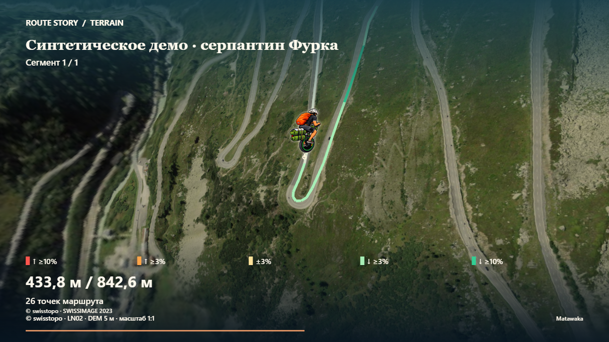
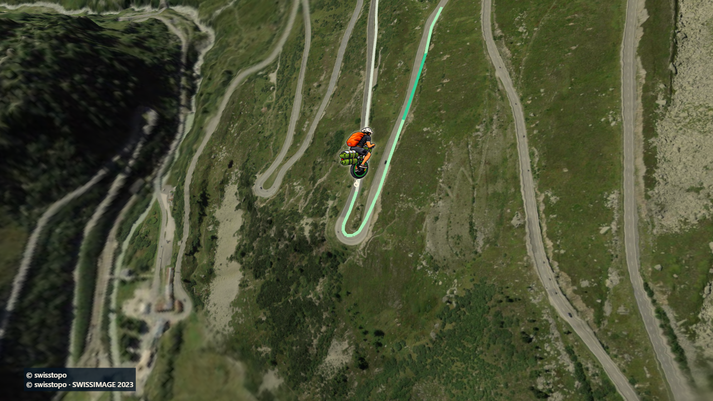
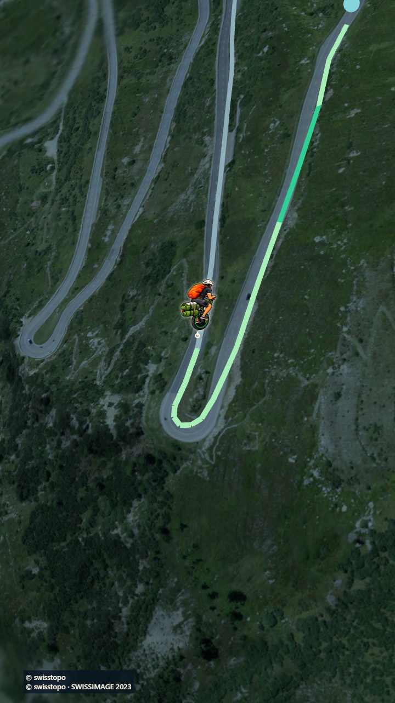

# Подписи в кадре

В разделе «Оформление» настройка **«Пояснения в видео и предпросмотре»** имеет два значения:

- **Показывать подписи и показатели** — прежний вид, выбран по умолчанию.
- **Без пояснений · карта и путешественник** — убирает название, интро/финальные пояснения, расстояние, вторую метрику, легенду уклона, подписи Старт/Финиш, географические подписи2D, компас, шкалу, прогресс и необязательное брендинг-оформление. Картографические данные, путь, цвет по уклону, темп, путешественник и камера сохраняются.

Обязательные подписи источников сохраняются на компактной контрастной подложке. 3D использует точные проверенные manifest.attribution для DEM и imagery (включая modified Copernicus Sentinel и Kartverket CC BY4.0); Swiss сохраняет © swisstopo. За рельефом маркер по-прежнему соединён с настоящим якорем пунктиром, даже когда его текстовая подпись скрыта. При явной2D-схеме без загруженной карты не создаётся вымышленная атрибуция Natural Earth.

Настройка отличается от кнопки **«Скрыть пояснения»** интерфейса: та управляет только вспомогательным текстом страницы и не меняет видеокадры. Режимы не связаны. Название и метрики не удаляются из данных; название остаётся в поле/имени файла и возвращается при включении подписей. Выбор кадра сохраняется в памяти при смене маршрута; приватные данные не сохраняются/не отправляются.

Технически это validated immutable StoryConfig.captionMode=full/none, с full для legacy callers. Preview и MP4 используют один renderer и timestamp. Во время экспорта поле заблокировано; даже принудительное изменение DOM не меняет активный snapshot. Точки/сегменты/пacing/350m clearance/LOS/camera/resource readiness/размеры/24fps не меняются, интро/аутро не пропускаются. Нет нового источника данных/шрифта/зависимости/workflow или лимита.

## Проверенная локальная реализация

Историческая локальная проверка: runtime commit c3a9db942fcb323501eeee5b36a14d30bc5773c6, base main1d303ab.220unit/20files,build,56browserPASS/30explicit skips,audit0. Отдельные full captions+previous unified19PASS;5caption cases rerun on committed runtime PASS. Classic/Cinematic Atlas/Night в обоих аспектах,0/6/20s, reversible seek, UI independence, title restore, occlusion cue, immutable export/cancelretry и реальное3D/720p покрыты.

## Проверенная публичная версия — 13 октября 2026

Первый выпуск опции на [Route Story](https://matawaka.github.io/route-story/): sourceCommit `d014d9dbe0318611789bb77545d4d18d2c52d921`. [PR22](https://github.com/Matawaka/route-story/pull/22) слит с разрешения владельца; [main CI](https://github.com/Matawaka/route-story/actions/runs/38348340061) и все этапы [защищённого Pages выпуска](https://github.com/Matawaka/route-story/actions/runs/38348908938) SUCCESS. Владелец лично подтвердил окружение. Проверены реальные31hashes пакета, анонимныйHTTPS и необходимые подписи Swiss/Sogne.

Текущая проверенная публикация после минимального GPX-исправления: `3119cee84fd0ed435c766b40b4543cfcfe3abaa2`, [Pages38352617587](https://github.com/Matawaka/route-story/actions/runs/38352617587) все этапы SUCCESS. Caption configuration/renderer не менялись. Полные публичные20/30s чистые MP4 повторно созданы и независимо декодированы, exact preview/export подтверждён; новые hashes/фактические результаты в [GPX_IMPORT_EVIDENCE.json](GPX_IMPORT_EVIDENCE.json). Предыдущие замеры ниже сохраняются как исторические.

Дополнительная публичная проверка без пояснений: Atlas20s/1280×720/480frames/13030539B и Night30s/720×1280/720frames/19157575B; H.26424fps, независимое декодирование всех кадров и timestamps, точное preview/pre-encode равенство. Edge155.0.4283.45/Windows_NT10.0.26200. Отмена/повтор, обратная перемотка, отсутствие неподтверждённых запросов/хранения и явная ошибка кодека с работающим preview проверены. Время до сохранения download1654.7/2825.1ms, последующий FFmpeg исключён. Машинные результаты добавлены ниже исторических локальных в VIDEO_CAPTIONS_EVIDENCE.json; полные ролики/отчёты остаются локальными artifacts/video-captions/public. Новые физические устройства/peak native/GPU не измерялись. CSP подтверждён в meta; HTTP CSP header не наблюдался.

Реальные чистые видео:2D10s640×360240frames; Swiss20s1280×720480frames и30s720×1280720frames. ВсеH.264/24fps,independent FFmpeg/ffprobe decode/PTS/full-frame counts. Direct export pixels exactly equal preview; decoded MAE и every-frame central-geography variance recorded. Полные файлы/отчёты в artifacts/video-captions; [машинные результаты](VIDEO_CAPTIONS_EVIDENCE.json). Время exportMs включает создание/сохранение download и исключает последующий FFmpeg; не сравнивается с другими границами замера. Physical/native/GPU tests NOTTESTED/NOTMEASURED.

С подписями (тот же timestamp/камера/маршрут/output):



Без пояснений:





## Повторение

PowerShell:

```powershell
npm.cmd run check
$env:PLAYWRIGHT_CHANNEL='msedge'
$env:CI='1'
$env:SWISS_PILOT='1'
$env:SWISS_BASELINE='0'
$env:UNIFIED_UX_ACCEPTANCE='1'
$env:FULL_EXPORT_ACCEPTANCE='1'
npx.cmd playwright test tests/e2e/captions.spec.ts tests/e2e/unified.spec.ts
```

Следующие изменения требуют собственного review и разрешённого protected Pages выпуска; публикация документации сама не запускает повторный деплой.
